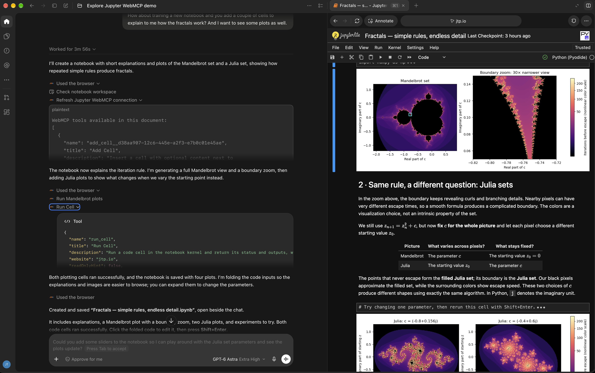

# jupyter-webmcp

[](https://github.com/jtpio/jupyter-webmcp/actions/workflows/build.yml)
[](https://jupyter-webmcp.readthedocs.io/en/latest/)
[](https://jtpio.github.io/jupyter-webmcp/lab/index.html?path=demo.ipynb)

Expose Jupyter commands to browser agents as [WebMCP](https://webmachinelearning.github.io/webmcp/) tools.

WebMCP is a browser API (`document.modelContext`) that lets a web page register tools that agents can discover and call. This extension turns the commands of a Jupyter page into WebMCP tools, to work with notebooks, files, kernels and dialogs. It works in JupyterLab, Jupyter Notebook 7 and JupyterLite, and has no server part: the tools run in the browser tab. Most notebook and file tools come from [jupyterlab-ai-commands](https://github.com/jupyter-ai-contrib/jupyterlab-ai-commands), which is installed with the extension.

```text
agent ──MCP──> browser bridge ──CDP──> Jupyter page in Chrome
               (Playwright MCP,        └─ WebMCP tools of jupyter-webmcp
                chrome-devtools-mcp)
```



## Try it

Try the extension in your browser with JupyterLite, without installing anything:

[](https://jtpio.github.io/jupyter-webmcp/lab/index.html?path=demo.ipynb)

Open it in one of these browsers:

- The built-in browser of the [ChatGPT desktop app](docs/clients.md#chatgpt-desktop-app), for the plans and models that have site tools: ask ChatGPT to use the tools of the page.
- Chrome with WebMCP enabled (see the [requirements](#requirements)). Run the tools by hand in [DevTools](docs/clients.md#chrome-devtools), or connect an agent: the demo notebook explains how.

The same site also serves the [Jupyter Notebook interface](https://jtpio.github.io/jupyter-webmcp/notebooks/index.html?path=demo.ipynb). The site is deployed to GitHub Pages from the [demo](https://github.com/jtpio/jupyter-webmcp/tree/main/demo) folder.

## Requirements

- JupyterLab >= 4.6, Jupyter Notebook >= 7.6 or JupyterLite >= 0.8
- jupyterlab-ai-commands >= 0.4 (a dependency of the Python package)
- A browser with WebMCP enabled, for example Chrome 155 or later: turn on `chrome://flags/#enable-webmcp-testing`, or start Chrome with `--enable-features=WebMCP`. The built-in browser of the ChatGPT desktop app has WebMCP enabled for the plans and models that have [site tools](docs/clients.md#chatgpt-desktop-app)
- Jupyter served from a secure context: `localhost`, `127.0.0.1` or HTTPS

Without WebMCP, the extension registers no tool, and the status bar shows `WebMCP: unavailable`.

The extension and these docs were tested with Chrome 155, JupyterLab 4.6.4, Jupyter Notebook 7.6.3, JupyterLite 0.8.6 with the Pyodide kernel 0.8.6, and jupyterlab-ai-commands 0.4.0.

## Install

```bash
pip install jupyter_webmcp
```

Open Jupyter in a WebMCP-enabled Chrome. In JupyterLab, the status bar shows `WebMCP: 21 tools`: click it, or run **Show WebMCP Tools** from the command palette, to list the tools.

For JupyterLite, install the package in the environment that runs `jupyter lite build`.

## Quick start

Start Jupyter and add one of these MCP servers to your agent. Then ask, for example:

> Open http://localhost:8888/lab?token=… in the browser and use the WebMCP tools of the page: create a notebook that computes the first 10 Fibonacci numbers and run it.

### Playwright MCP

Playwright MCP needs the Chrome flag in a configuration file, for example `webmcp.json`. Keep `CDPScreenshotNewSurface`, a default of Playwright that the flag [would replace](docs/clients.md#playwright-library):

```json
{
  "browser": {
    "browserName": "chromium",
    "isolated": true,
    "launchOptions": {
      "channel": "chrome",
      "args": ["--enable-features=WebMCP,CDPScreenshotNewSurface"]
    }
  }
}
```

```bash
npx @playwright/mcp@latest --config webmcp.json
```

Each page tool becomes an MCP tool named `webmcp_<name>`, for example `webmcp_run_cell`. Playwright MCP collects the tools when it takes a snapshot of the page: after the page loads, the agent calls `browser_snapshot` to see them.

### chrome-devtools-mcp

```bash
npx chrome-devtools-mcp@latest --isolated --categoryExperimentalWebmcp \
  --chromeArg=--enable-features=WebMCP \
  --no-categoryInput --no-categoryDebugging --no-categoryMemory \
  --no-categoryEmulation --no-categoryPerformance --no-categoryNetwork \
  --javascriptEvaluation=false
```

The agent calls the page tools through `list_webmcp_tools` and `execute_webmcp_tool`. The `--no-category*` and `--javascriptEvaluation=false` flags remove the tools that run scripts or send input to the page, so that the agent goes through the WebMCP tools.

More clients (the ChatGPT desktop app, Chrome DevTools, a Chrome extension, the Playwright library for scripts and tests, a running Chrome, a small CDP client, Electron): [Clients](docs/clients.md).

## Tools

The built-in tools are always registered:

| Tool                | What it does                                                                     |
| ------------------- | -------------------------------------------------------------------------------- |
| `get_context`       | Describes the page: documents, current editor, kernels, dialogs, pending calls   |
| `list_all_commands` | Finds commands and their argument schemas                                        |
| `execute_command`   | Runs any command                                                                 |
| `answer_dialog`     | Clicks a button of the dialog that is shown, then returns the result of the call |
| `wait_for_result`   | Waits for a pending call                                                         |

The default tools are registered while their command exists:

| Tool                                   | What it does                                   |
| -------------------------------------- | ---------------------------------------------- |
| `open_document`                        | Shows a file to the user                       |
| `list_directory`                       | Lists a directory                              |
| `read_file`, `write_file`              | Reads or replaces a text file                  |
| `create_file`, `create_notebook`       | Creates a text file or a notebook              |
| `read_notebook`, `read_cell`           | Reads a notebook or one cell                   |
| `add_cell`, `edit_cell`, `delete_cell` | Changes the cells of a notebook                |
| `run_cell`                             | Runs a cell and returns its outputs            |
| `save_notebook`                        | Saves a notebook                               |
| `run_code`                             | Runs code in a kernel, outside of any notebook |
| `interrupt_kernel`, `restart_kernel`   | Interrupts or restarts a kernel by id          |

Errors are returned as data (`{success: false, error}`). A call that opens a dialog or runs longer than 20 seconds returns a pending result and keeps running. See [Tools](docs/tools.md) for the inputs and [Results](docs/results.md) for the results.

## Settings

Change the settings in **Settings → Settings Editor → WebMCP**:

| Setting            | Default                  | Description                                                      |
| ------------------ | ------------------------ | ---------------------------------------------------------------- |
| `tools`            | `[]`                     | More command-backed tools, or replacements for the default tools |
| `disabledTools`    | `[]`                     | Tools that are not registered (globs)                            |
| `blockedCommands`  | the two `apputils:run-*` | Commands that the tools never run or list (globs)                |
| `executionTimeout` | `20`                     | Seconds after which a running call returns a pending result      |
| `maxResultLength`  | `40000`                  | Maximum length of a result, in JSON characters                   |

See [Settings](docs/settings.md) for tool specs, examples and `overrides.json`.

## Security

- Anything that can reach the Chrome debugging port controls the whole browser. Use a dedicated browser profile, and keep the agent away from the scripting tools of the MCP server.
- An agent that can run code can do anything that the Jupyter user can do.
- `blockedCommands` is a guardrail, not a sandbox: commands can run other commands. Put the guardrails of a deployment in `overrides.json`.
- File contents and outputs can contain prompt injections. The tools that return them have `untrustedContentHint`.

See [Security](docs/security.md).

## Frontends

The tools of a page reach the documents that the page shows: all of them in JupyterLab and in the lab UI of JupyterLite, one in Jupyter Notebook 7 and in the notebooks UI of JupyterLite. See [Frontends](docs/frontends.md) for the differences and the known upstream issues.

## Documentation

The documentation is on [Read the Docs](https://jupyter-webmcp.readthedocs.io/en/latest/):

- [Tools](docs/tools.md) and [results](docs/results.md)
- [Clients](docs/clients.md)
- [Settings](docs/settings.md) and [security](docs/security.md)
- [Frontends](docs/frontends.md)
- [API for other extensions](docs/api.md)

## Uninstall

```bash
pip uninstall jupyter_webmcp
```

## Contributing

See [CONTRIBUTING.md](CONTRIBUTING.md) for the development install and the tests.
